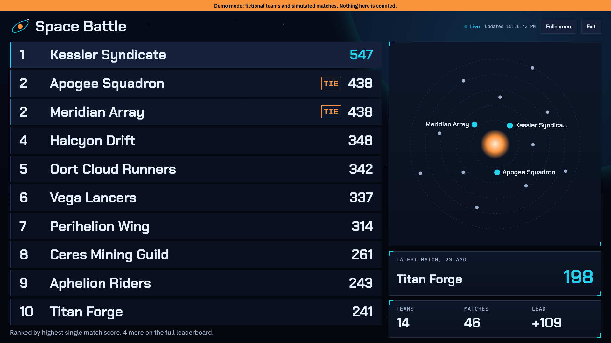

# SPACE BATTLE: Mission Control

A live tournament leaderboard with a public score API and a hidden coordinator panel, for the TSA@RHS Webmaster qualifier. Built with Python (Flask), HTML, and CSS, using SQLite on your computer and Postgres on the live site.

**Live site:** https://space-battle-teal.vercel.app

> **Authorship notice:** this code, design, and text were generated with AI assistance (Claude, by Anthropic). The competition requires key parts of an entry to be the team's original work, so check the organizers' AI rules before submitting it. See [CREDITS.md](CREDITS.md).



## Run the demo

You need Python 3.10 or newer.

**Mac or Linux**
```bash
python3 -m venv .venv
source .venv/bin/activate
pip install -r requirements.txt
python app.py --demo
```

**Windows**
```bash
python -m venv .venv
.venv\Scripts\activate
pip install -r requirements.txt
python app.py --demo
```

Then open http://localhost:8000. The admin page is http://localhost:8000/ops/demo and the password is `demo`.

Demo mode uses made-up teams in a separate file (`demo.db`), adds new fake matches as the board runs, and shows an orange banner on every screen. It never touches real results.

## Pages

| Address | What it is |
|---|---|
| `/` | Live leaderboard |
| `/display` | Full-screen projector view |
| `/rules` | How scoring works |
| `/api-guide` | How to send results |
| `/about` | Team and citations |
| `/ops/<secret path>` | Hidden coordinator panel |

## The API

Send a match:

```bash
curl -X POST http://localhost:8000/api/results \
  -H "Content-Type: application/json" \
  -d '{"name": "Nova Squad", "score": 250}'
```

| Field | Required | Rules |
|---|---|---|
| `name` | Yes | Text, 1 to 40 characters |
| `score` | Yes | Signed whole number, no typical-range limit |
| `submissionId` | No | Your own match ID, so a retry is not counted twice |

| Status | Meaning |
|---|---|
| 201 | Saved |
| 200 | Repeat of a `submissionId`. Nothing added |
| 400 | Invalid request. The `error` field explains why |
| 405 | Wrong HTTP method |
| 409 | `submissionId` reused with a different name or score |
| 413 | Request over 10 KB |
| 503 | Database unavailable. Safe to retry |

`GET /api/leaderboard` returns the standings as JSON.

## Ranking

- A team's rank comes from its **highest single match score**.
- Tied teams **share a rank** (1, 1, 3). The team that reached the score first is listed first.
- Capitalization and extra spaces are ignored in team names.
- Without a `submissionId`, identical requests count as separate matches, because two matches can have the same score.

## Run for real

Set a password and a secret admin address, then start the app. Without these two, the admin page stays switched off.

```bash
export ADMIN_PASSWORD="choose-a-long-password"
export ADMIN_PATH="choose-a-secret-word"
export SECRET_KEY="any-long-random-text"
python app.py
```

Results are saved in `spacebattle.db`, which is deliberately not uploaded to GitHub. If a `DATABASE_URL` setting exists, results go to that Postgres database instead.

## Admin panel

Go to `/ops/<ADMIN_PATH>` and enter the password. You can search, filter, add, correct, and delete results, download a backup, and reset the tournament. Reset requires typing `RESET TOURNAMENT`.

## Hosting

The live site runs on **Vercel** with a free **Neon Postgres** database. Vercel erases files between requests, so SQLite cannot be used there. `database.py` switches to Postgres whenever `DATABASE_URL` is set.

How it was set up:

1. `npx vercel link` created the Vercel project. Vercel finds `app.py` and `requirements.txt` by itself.
2. `npx vercel integration add neon` created the database and added `DATABASE_URL` to the project.
3. `ADMIN_PASSWORD`, `ADMIN_PATH`, and `SECRET_KEY` were added as sensitive variables with `npx vercel env add`.
4. `npx vercel deploy --prod` put it online. The table is created automatically on the first request.
5. `python tests/live_check.py https://space-battle-teal.vercel.app` tested it. That script creates test teams, so reset the tournament afterward.

To update the live site after changing code, run `npx vercel deploy --prod` again. `.vercelignore` keeps tests, screenshots, and local databases out of the upload.

## Tests

```bash
python -m unittest discover tests
```

To test a running server, including 50 requests at the same moment:

```bash
python tests/live_check.py http://localhost:8000
```

## How the code is organized

| File | Job |
|---|---|
| `app.py` | Web addresses and what each one does |
| `rules.py` | Validation and ranking, as plain functions |
| `database.py` | Every SQL statement, for SQLite and Postgres |
| `templates/` | The HTML pages |
| `static/style.css` | All of the design |
| `static/live.js` | Refreshes the board every 3 seconds |

Read [HOW_IT_WORKS.md](HOW_IT_WORKS.md) for a walkthrough.

## Before submitting

- Replace `TEAM_MEMBERS` in `app.py` with real names
- Confirm the AI rules and any annual theme with the organizers
